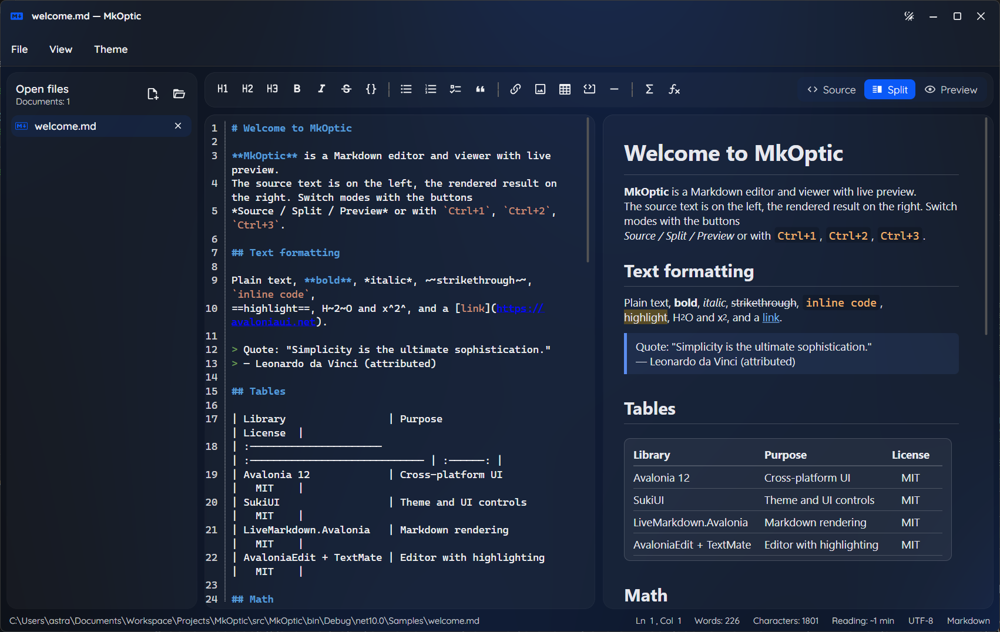

# 📝 MkOptic

   

A simple, fast Markdown editor and viewer for Windows, macOS and Linux. Write on the left, see the result on the right.



## ✨ What it can do

- 🖊️ **Edit and preview side by side.** Three modes: *Source*, *Split* and *Preview* (`Ctrl+1` / `Ctrl+2` / `Ctrl+3`). Both panes scroll together.
- 📂 **Many files at once.** Open documents are listed in a side panel; unsaved ones are marked. Drag files into the window to open them.
- 🪟 **One application instance per user.** Launching MkOptic again activates the existing window and restores it if minimized. Files passed to a subsequent launch open in that same window.
-  **Rich Markdown.** Tables, task lists, quotes, code blocks with syntax highlighting, images, and math formulas (`$a^2 + b^2 = c^2$`).
- 🖼️ **SVG images and badges.** Preview local and remote SVG images.
- ️ **Formatting toolbar and shortcuts.** Headings, bold, italic, lists, links, images, tables and more in one click (`Ctrl+B`, `Ctrl+I`, `Ctrl+K`, ...).
- 🔍 **Find in source and preview** (`Ctrl+F`) with match highlighting and navigation.
- 📑 **Collapsible table of contents.** Browse headings in the right panel and click to jump to any section. Updates automatically as you edit.
- 🔠 **Shared source and preview font zoom** (`Ctrl+=` / `Ctrl+-`, `Ctrl+0` to reset), preserving preview heading and code proportions, and live word count.
- 💾 **Safe saving.** Files are written atomically and you are asked before losing unsaved changes.
- 📤 **Export to HTML and PDF.** Export the current text, including unsaved edits, from the File menu without changing the Markdown source.
-  **External file changes.** Reload files changed by another program or save your version under a different name. Enable **View → Auto-reload unmodified files** (off by default) to refresh files without local edits automatically, with a brief bottom-left notification.
- 🔗 **Links that work.** Web links open in your browser, links to other `.md` files open in a new tab.
- 🎨 **Light and dark themes** with a choice of accent color.

## 📥 Download

Get the latest build from the [Releases](https://github.com/ambyte/MkOptic/releases) page:

| System | Package |
| --- | --- |
| 🪟 Windows | `*-win-x64-setup.exe` installer, or `*-win-x64-portable.exe` (a single file, no installation) |
| 🍎 macOS | `*-macos-arm64.dmg` (Apple Silicon) or `*-macos-x64.dmg` (Intel) |
| 🐧 Linux (Debian, Ubuntu, ...) | `*.deb` |
| 🐧 Linux (Fedora, openSUSE, ...) | `*.rpm` |

Notes:

- The builds are self-contained: no .NET installation is required.
- macOS builds are not notarized. On first launch, right-click the app and choose **Open**.
- Windows may show a SmartScreen warning because the executable is not code-signed.

### 📄 Opening `.md` files with MkOptic

- **Windows installer:** keep the "Register MkOptic for Markdown files" option checked. Then choose MkOptic in *Settings → Apps → Default apps* (Windows does not allow installers to change your default silently), or use *Open with → Choose another app* on any `.md` file and tick "Always use this app".
- **Linux (`.deb` / `.rpm`):** MkOptic registers itself for the `text/markdown` type, so it appears in the "Open With" menu of your file manager; pick it as the default there.
- **macOS:** MkOptic is registered for Markdown files; use *Get Info → Open with → Change All...* in Finder.
- **Portable Windows build:** does not register anything. Use the installer if you want file associations.

You can also pass files on the command line: `MkOptic README.md notes.md`.

If MkOptic is already running, these files are forwarded to its existing window (relative paths are resolved from the new launch's working directory). Launching without files simply activates the window; it does not open another instance or discard unsaved documents.

## 📤 Exporting documents

Open a document and select **File → Export to HTML…** or **File → Export to PDF…**, then choose the destination in the native save dialog. Export works for both saved and untitled documents. It uses a snapshot of the current editor text (not the delayed preview), leaves the source path and unsaved-changes state untouched, and reports success or an error with an in-app notification. Export commands are disabled when no document is active.

- **HTML:** a UTF-8 page with built-in light styles, responsive layout, tables, task lists, links, and code blocks. Local PNG/JPEG/GIF/SVG/WebP images are embedded, so they do not depend on the export location. Remote HTTP(S) images remain remote and require network access when viewing the page. Relative links resolve against the original Markdown file. Raw HTML is escaped and a Content Security Policy blocks scripts and other active content.
- **PDF:** generated locally, without a browser, printer driver, external service, or license key. Uses A4 pages with page numbers and embedded Inter fonts, including Cyrillic. Supports headings, bold/italic text, paragraphs, lists, task lists, quotes, tables, code, web links, and local PNG/JPEG images. Long documents are paginated automatically. PDF has its own print layout rather than reproducing the application's current theme or zoom.
- **Current limitations:** formulas are exported as TeX text rather than typeset math; code has no syntax coloring. PDF uses alternative-text placeholders for remote images and image formats other than PNG/JPEG. Relative resources in untitled documents have no source directory; save the Markdown first to resolve them. Each local image is limited to 20 MB; missing or unreadable supported local images fail the export without replacing an existing destination. Network-share images are not read or embedded.

The save dialog asks before overwriting an existing destination. Exports cannot overwrite an open Markdown document. Output is written to a temporary file and moved into place only after successful generation, protecting an existing export if conversion or writing fails.

## ⚙️ Settings

Defaults are built into the application. To change them, put an `appsettings.json` next to the executable (Windows portable) or set environment variables with the `MKOPTIC_` prefix, for example `MKOPTIC_Editor__FontSize=16`.

| Key | Default | Description |
| --- | --- | --- |
| `Appearance:BaseTheme` | `Dark` | Startup theme: `Dark` / `Light` |
| `Appearance:AccentColor` | `Blue` | `Blue`, `Green`, `Orange`, `Red` |
| `Editor:PreviewDelayMilliseconds` | `250` | Preview refresh delay after typing (0–5000) |
| `Editor:MaxFileSizeMegabytes` | `20` | Maximum size of an opened file (1–512) |
| `Editor:FileExtensions` | `.md`, `.markdown`, ... | Extensions offered in dialogs and followed in links |
| `Editor:DefaultViewMode` | `Split` | `Editor` / `Split` / `Preview` |
| `Editor:FontSize`, `Editor:FontFamily` | `14`, `Cascadia Code, ...` | Source font size and family; font size also scales preview typography (preview keeps its own fonts) |
| `Editor:WordWrap`, `Editor:ShowLineNumbers` | `true` | Word wrap and line numbers |
| `Logging:LogLevel:*` | `Information` | Logging levels |

Invalid values are reported at startup and the application exits with a clear error. `MKOPTIC_ENVIRONMENT=Development` additionally loads `appsettings.Development.json` (present in Debug builds).

## ⌨️ Keyboard shortcuts

| Action | Keys |
| --- | --- |
| New / open / close | `Ctrl+N` / `Ctrl+O` / `Ctrl+W` |
| Save / save as / save all | `Ctrl+S` / `Ctrl+Shift+S` / `Ctrl+Alt+S` |
| Source / Split / Preview | `Ctrl+1` / `Ctrl+2` / `Ctrl+3` |
| Bold / italic / code / link | `Ctrl+B` / `Ctrl+I` / `Ctrl+E` / `Ctrl+K` |
| Inline formula | `Ctrl+M` |
| Heading 1 / 2 / 3 | `Ctrl+Alt+1` / `Ctrl+Alt+2` / `Ctrl+Alt+3` |
| Focus search | `Ctrl+F` (works from source, preview and the menu) |
| Next / previous match | `F3` / `Shift+F3`; `Enter` / `Shift+Enter` while the search field has focus |
| Clear search and return to source or preview | `Escape` while the search field has focus |
| Next / previous document | `Ctrl+Tab` / `Ctrl+Shift+Tab` |
| Open files panel | `Ctrl+\` |

## 📚 Third-party libraries

MkOptic is built on these open-source projects. Thank you to their authors!

| Library | What it gives MkOptic | License |
| --- | --- | --- |
| [Avalonia](https://github.com/AvaloniaUI/Avalonia) | Cross-platform user interface | MIT |
| [SukiUI](https://github.com/kikipoulet/SukiUI) | Themes, window, dialogs and notifications | MIT |
| [LiveMarkdown.Avalonia](https://github.com/DearVa/LiveMarkdown.Avalonia) (+ `.Math`, `.Svg.Skia`) | Markdown preview: tables, code, bitmap/SVG images, formulas | Apache-2.0 |
| [Markdig](https://github.com/xoofx/markdig) | Markdown parsing for preview and export | BSD-2-Clause |
| [PDFsharp & MigraDoc 6.2.4](https://github.com/empira/PDFsharp/tree/v6.2.4) | Local PDF generation, text layout, pagination, and font embedding | MIT |
| [RaTeX.Net](https://github.com/Sylinko/RaTeX.Net) | Rendering of LaTeX formulas | see repository |
| [AvaloniaEdit](https://github.com/AvaloniaUI/AvaloniaEdit) + AvaloniaEdit.TextMate | Source editor with syntax highlighting | MIT |
| [TextMateSharp](https://github.com/danipen/TextMateSharp) | Markdown grammars for highlighting | MIT |
| [Material.Icons.Avalonia](https://github.com/SKProCH/Material.Icons.Avalonia) | Icons | MIT |
| [Inter](https://github.com/rsms/inter) (Avalonia.Fonts.Inter) | UI font | SIL OFL 1.1 / MIT package |
| [CommunityToolkit.Mvvm](https://github.com/CommunityToolkit/dotnet) | MVVM helpers | MIT |
| [Microsoft.Extensions.*](https://github.com/dotnet/runtime) | Dependency injection, configuration, logging | MIT |

Build and packaging tools: [Inno Setup](https://jrsoftware.org/isinfo.php) (Windows installer), [fpm](https://github.com/jordansissel/fpm) (deb and rpm).

## 📜 License

MkOptic is released under the [MIT License](LICENSE). Third-party components keep their own licenses listed above.

---

## 👨‍💻 For developers

### 📋 Requirements

- [.NET SDK 10](https://dotnet.microsoft.com/download) (version pinned in `global.json`)

### 🔨 Build, run and test

```bash
dotnet build
dotnet run --project src/MkOptic                 # empty start screen
dotnet run --project src/MkOptic -- README.md    # open files right away
dotnet test
```

On Windows, `debug.bat` restores packages, builds in Debug and runs the app with `MKOPTIC_ENVIRONMENT=Development`; arguments are passed to the application (`debug.bat README.md`).

Debug builds use [HotAvalonia](https://github.com/Kira-NT/HotAvalonia) for XAML hot reload in `Minimal` mode (`HotAvaloniaMode` in `MkOptic.csproj`): only the edited file is reloaded. Other modes also reload `MainWindow`, which crashes the app because the SukiUI window hook accesses a detached visual. Restart the app after editing `MainWindow.axaml` itself.

### 📦 Packaging and releases

[`.github/workflows/ci.yml`](.github/workflows/ci.yml) builds, tests and checks packages for known vulnerabilities on Windows (x64 and ARM64), Linux and macOS for every push to main and every pull request. Windows ARM64 tests run natively on the `windows-11-arm` runner.

[`.github/workflows/release.yml`](.github/workflows/release.yml) produces the distributable packages. Push a tag such as `v1.0.0` to build everything and publish a GitHub release; run the workflow manually to get the packages as build artifacts only. Windows x64 and ARM64 are published as separate artifacts, each containing a portable executable and an installer; ARM64 is cross-compiled on the Windows x64 runner.

| Platform | Output | How |
| --- | --- | --- |
| Windows (x64, ARM64) | portable single `.exe`, installer `.exe` for each architecture | `dotnet publish -p:PublishSingleFile=true` (native libraries and default settings are embedded), then Inno Setup ([`packaging/windows/mkoptic.iss`](packaging/windows/mkoptic.iss)) with the matching architecture |
| macOS | `.dmg` with `MkOptic.app` (arm64, x64) | `packaging/macos/build-dmg.sh`; `Info.plist` declares the Markdown document type |
| Linux | `.deb`, `.rpm` (x64, arm64) | `packaging/linux/build-packages.sh` (fpm); `mkoptic.desktop` declares the `text/markdown` type |

To build a single-file Windows executable locally:

```bash
dotnet publish src/MkOptic -c Release -r win-x64 -p:PublishSingleFile=true -o artifacts/win
```

For Windows ARM64, use:

```bash
dotnet publish src/MkOptic -c Release -r win-arm64 -p:PublishSingleFile=true -o artifacts/win-arm64
```

When compiling the installer with Inno Setup, pass `/DAppArch=arm64` and point `/DSourceExe` to the ARM64 executable. The default installer architecture remains x64; the ARM64 installer only allows installation on ARM64 Windows.

### 🗂️ Project structure

```text
MkOptic.sln
├── src/MkOptic.Core          # UI-free logic (easy to test)
│   ├── Documents/            # DocumentViewMode, DocumentStatistics, LinkResolver
│   ├── Editing/              # MarkdownFormatter: computes edits for the formatting toolbar
│   ├── Files/                # IMarkdownFileService: size-limited reads, atomic writes
│   ├── Options/              # EditorOptions + DataAnnotations validation
│   └── Threading/            # TimeProvider-based Debouncer (preview delay)
├── src/MkOptic               # Avalonia application
│   ├── ServiceRegistration.cs# Composition root: configuration, logging, DI
│   ├── EmbeddedResources.cs  # Default settings and sample document compiled into the exe
│   ├── Services/             # File dialogs, SukiUI dialogs/notifications, themes
│   ├── ViewModels/           # MainWindowViewModel, DocumentViewModel, EditorSettingsViewModel
│   ├── Views/                # MainWindow (composition only), DocumentView, DocumentSidebarView, ...
│   ├── Styles/               # App styles and preview palette (light/dark)
│   └── Samples/welcome.md    # Sample document with tables and formulas
├── tests/MkOptic.Tests       # xUnit v3: Core and view models with fake services
├── packaging/                # Inno Setup script, macOS bundle files, Linux deb/rpm scripts
└── .github/workflows/        # ci.yml (build + tests), release.yml (packages + GitHub release)
```

### 🏛️ Architectural decisions

- **MVVM + DI.** View models do not depend on windows: the file system, dialogs, notifications and themes are hidden behind interfaces (`IMarkdownFileService`, `IFileDialogService`, `IUserInteractionService`, `IThemeService`), so open, save and close scenarios are covered by unit tests.
- **Change tracking** relies on the AvaloniaEdit undo stack (`UndoStack.IsOriginalFile`); undoing back to the saved state makes the document clean again.
- **Document export.** `IDocumentExportService` separates export commands from conversion and disk I/O. Markdig parses the captured editor text; HTML uses its HTML renderer with embedded CSS, while MigraDoc builds a paginated PDF with the shipped Inter fonts through a dedicated font resolver (no OS-font dependency). Parsing and PDF layout run off the UI thread. Local image reads and output writes are asynchronous; final output replacement is atomic. Tests cover rich Markdown, UTF-8 and Unicode metadata, embedded fonts/images, pagination, unsafe content, source protection, cancellation, failures, command availability, and tab changes during the native dialog. PDFsharp is pinned to the MIT-licensed 6.2.4 release; its older cryptography dependency is explicitly upgraded to the serviced .NET 10 version, with NuGet Audit left enabled.
- **Preview** is refreshed with a delay (`Debouncer`) so fast typing does not re-render on every keystroke. Time comes from `TimeProvider`, so tests use `FakeTimeProvider`.
- **Text-based scroll synchronization.** The view maps Markdown source spans to rendered text-line positions, including nested lists, tables and code. Wrapped lines use local text anchors; blank lines and non-text regions interpolate between nearby anchors. Preview margins and editor wrapping are accounted for, horizontal offsets and the caret are preserved, and the target is clamped to its scrollable range. Synchronization pauses while the debounced preview is stale and during restoration of a document's saved scroll positions. Unit tests cover the bidirectional map, and headless UI tests verify rendered text anchors and actual scrolling in both directions.
- **Formatting** is a pure function `MarkdownFormatter.Apply(format, text, selection) → TextEdit`; the view only applies the edit. The line-ending style (LF/CRLF) is preserved.
- **Document search.** The persistent [search bar](src/MkOptic/Views/DocumentSearchBar.axaml) lives beside the main menu and binds to the active view exposed by [DocumentHost](src/MkOptic/Views/DocumentHost.cs). [DocumentSearch](src/MkOptic/Views/DocumentSearch.cs) owns per-view query/navigation state and shares LiveMarkdown's immutable literal search pattern between source ranges and block-local rendered search (ordinal, case-insensitive substring matching). Source highlights use an AvaloniaEdit background renderer; preview highlights use LiveMarkdown's named highlight registry and precise text-range coordinates for scrolling. No regex, option toggles or AvaloniaEdit replacement/search overlay are installed. Headless UI tests cover compact menu alignment, borderless actions, both themes, keyboard input, rendered-only matching, preview scrolling, case-insensitive Latin/Cyrillic matching, literal punctuation, content updates and document switching.
- **Preview palette.** The default LiveMarkdown resources only suit a dark background, so they are replaced with a custom light/dark palette (`Styles/MarkdownPalette.axaml`).
- **Preview images.** LiveMarkdown's Skia SVG decoder is registered before the bitmap decoder at startup. It detects SVG content without relying on a file extension, so remote badges such as the Shields.io badges at the top of this README render without changing their URLs.
- **Single-file friendly.** `appsettings.json` and the sample document are embedded resources; an `appsettings.json` next to the executable is an optional override. The sample is written to the per-user data folder when opened, because the editor works with files on disk.
- **Opening files from the OS.** Command-line arguments are opened on startup; macOS Finder file-open events arrive through `IActivatableLifetime`.
- **Single-instance coordination.** A per-user named mutex and named pipe forward launches to the existing window. Their shared name uses a fixed-length, 128-bit SHA-256-derived identifier covering both the application ID and user identity, keeping the pipe's Unix socket path within macOS's 104-byte limit with the standard macOS temporary-directory layout. Regression tests cover path length, deterministic application/user isolation, and activation with long Unicode application IDs.
- **Errors.** Expected I/O errors are logged and shown as notifications. Unhandled UI-thread exceptions are logged and shown but do not terminate the process, so unsaved documents are not lost.

### ✅ Code quality

- Nullable reference types, `TreatWarningsAsErrors`, .NET analyzers (`AnalysisMode=Recommended`), `EnforceCodeStyleInBuild`; style is defined in `.editorconfig`.
- Package versions are managed centrally (`Directory.Packages.props`); NuGet Audit covers direct and transitive dependencies.
- Structured logging via source-generated `LoggerMessage`. Logs contain only file names, never document contents.
